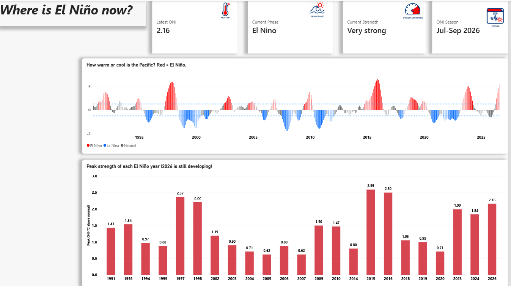
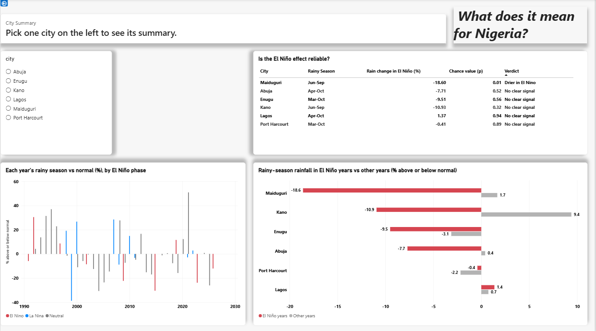
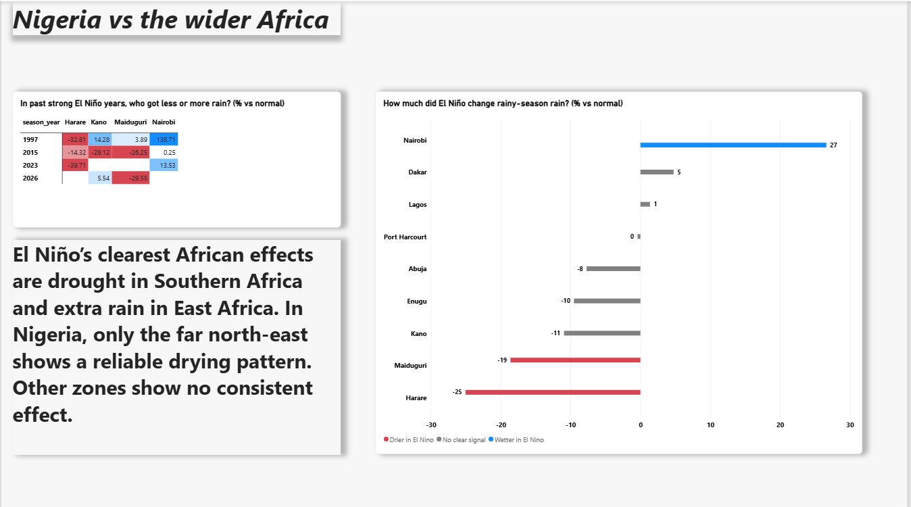

# -El-Nino-Rainfall-Impact-Analysis-Nigeria-and-Africa
This project shows how strong the current El Niño is and what past El Niño events did to rainy-season rainfall in Nigeria, East Africa and Southern Africa. It uses Python to collect and clean the data and a three-page Power BI dashboard to show the results.

## Key findings

-Southern Africa (drier) and East Africa (wetter) respond clearly to El Niño.

-Nigeria's response is weak and uneven. Only the north-east (Maiduguri) shows a statistically clear drying signal; the other five cities show no consistent effect.

-In the strong events of 1997, 2015 and 2023, Harare was below normal every time (−32.8%, −14.3%, −39.7%). Nairobi ranged from +0.3% (2015) to +138.7% (1997).

-Observed in the 2026 June–September season: Maiduguri −29.6%, Kano +5.5%.

-A monthly forecasting model added no reliable value for Nigerian cities (skill score between about −0.16 and +0.04 against a "normal month" baseline). Only Harare cleared the 0.05 threshold at 1 and 3 months ahead, so the findings rest on historical seasonal patterns, not a forecast.

| City | Region | Rain in El Niño years vs normal | Result |
|---|---|---|---|
| Maiduguri | Nigeria, North-East | −18.6% | Drier (clear) |
| Kano | Nigeria, North-West | −10.9% | No clear signal |
| Enugu | Nigeria, South-East | −9.5% | No clear signal |
| Abuja | Nigeria, North-Central | −7.7% | No clear signal |
| Lagos | Nigeria, South-West | +1.4% | No clear signal |
| Port Harcourt | Nigeria, South-South | −0.4% | No clear signal |
| Dakar | Senegal | +4.8% | No clear signal |
| Harare | Southern Africa | −25.0% | Drier (clear) |
| Nairobi | East Africa | +26.6% | Wetter (clear) |

*"vs normal" means compared with each city's 1991–2020 average for the same rainy season.*

## Dashboard

| Page | What it shows |
|---|---|
| 1. Where is El Niño now? | Current reading, a timeline since 1991, and the peak strength of each El Niño year |
| 2. What does it mean for Nigeria? | Rainfall change by city and whether the result is reliable |
| 3. Nigeria vs the wider Africa | Nigeria compared with Dakar, Nairobi and Harare, plus past strong events |







## Data sources

- **El Niño index (ONI and Niño-3.4):** NOAA Climate Prediction Center, https://www.cpc.ncep.noaa.gov/
- **Rainfall and temperature:** NASA POWER, https://power.larc.nasa.gov/

Period covered: January 1991 to September 2026. Cities: Kano, Maiduguri, Abuja, Lagos, Enugu, Port Harcourt, Nairobi, Harare and Dakar.

## Project files

| File | What it does |
|---|---|
| `config.py` | Settings: the cities, their coordinates and the years used |
| `01_pull_data.py` | Downloads the El Niño and weather data |
| `02_clean_build.py` | Cleans the data, labels each month El Niño, La Niña or Neutral, and calculates how far rainfall is from normal |
| `03_model.py` | Tests whether El Niño can predict monthly rainfall |
| `04_seasonal_analysis.py` | Compares whole rainy seasons in El Niño years with other years |
| `ElNino_Dashboard.pbix` | The Power BI dashboard |

## How to run it

You need Python 3.10 or newer.

```bash
git clone https://github.com/YOUR-USERNAME/el-nino-nigeria-africa.git
cd el-nino-nigeria-africa
pip install requests pandas scikit-learn
python 01_pull_data.py
python 02_clean_build.py
python 03_model.py
python 04_seasonal_analysis.py
```

The scripts create a `data` folder with the downloaded files (`data/raw`), the cleaned tables (`data/clean`) and the model results (`data/model`).

## Power BI steps

1. Open Power BI Desktop and choose **Get data**, then **Text/CSV**.
2. Load these four files from `data/clean`: `enso_monthly.csv`, `climate_monthly.csv`, `seasonal_by_year.csv` and `seasonal_signal.csv`.
3. Create the measures below (right-click a table, then **New measure**).

```dax
ONI Date = MAXX(FILTER(ALL(enso_monthly), NOT(ISBLANK(enso_monthly[oni]))), enso_monthly[date])
Latest ONI = LOOKUPVALUE(enso_monthly[oni], enso_monthly[date], [ONI Date])
Current Phase = LOOKUPVALUE(enso_monthly[phase], enso_monthly[date], [ONI Date])
Current Strength = LOOKUPVALUE(enso_monthly[strength], enso_monthly[date], [ONI Date])
ONI Season = FORMAT(EDATE([ONI Date], -1), "mmm") & "-" & FORMAT(EDATE([ONI Date], 1), "mmm yyyy")
City Summary = SELECTEDVALUE(seasonal_signal[insight], "Pick one city on the left to see its summary.")
```

To refresh with new data, re-run the four scripts and click **Refresh** in Power BI.

## Limitations

-Small samples: 6–7 El Niño seasons per Nigerian city and 11–12 for Harare and Nairobi, so averages are sensitive to individual years.

-Multiple testing: nine cities were tested at a 0.10 threshold, so about one false positive is expected by chance. Maiduguri's result is best described as suggestive.

-One point per zone: each city is a single satellite-based grid point, not an average of its whole zone. Annual totals can differ from weather-station records, which is why results are shown against each city's own normal.

-Rainfall and temperature only: crop yields, flooding and health outcomes are not analysed.

-Other climate drivers (for example Indian Ocean and Atlantic temperatures) also affect African rainfall and are not modelled.

-2026 is incomplete: some 2026 results are partial and the El Niño peak has not been confirmed.

-Not a forecast: results describe historical patterns, not a prediction for the coming season.

Data provided by the NOAA Climate Prediction Center and the NASA POWER project. This repository is an independent analysis and is not affiliated with either organisation.
